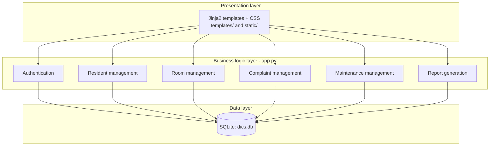
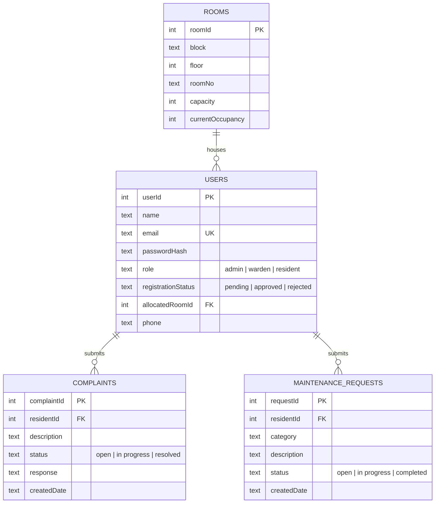
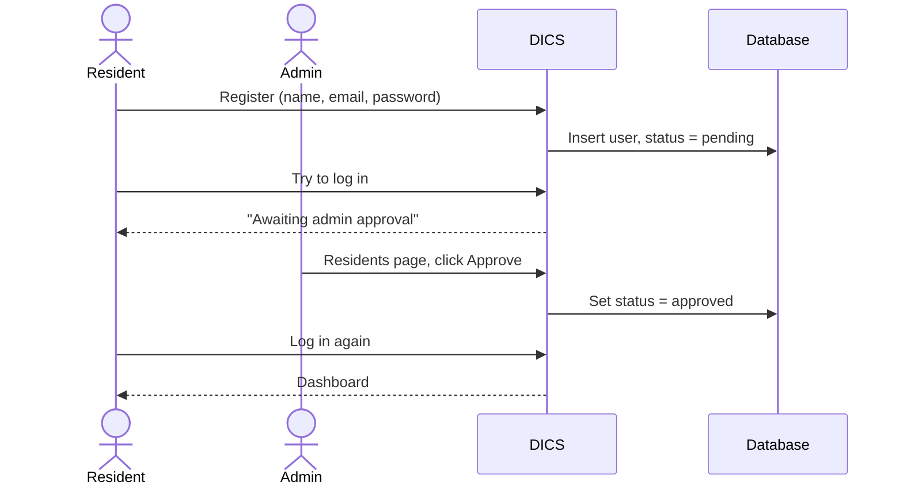
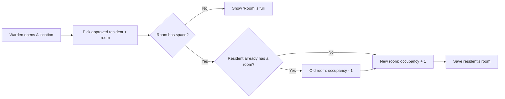
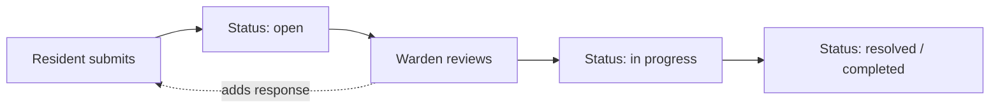

<div align="center">

# 🏠 DICS — Dormitory Information and Control System

**A web application that replaces manual dormitory record-keeping with one secure, role-based system for rooms, residents, complaints and maintenance.**


</div>

---

## 📖 Table of contents

1. [About the project](#-about-the-project)
2. [Features](#-features)
3. [Tech stack](#-tech-stack)
4. [Architecture](#-architecture)
5. [Database design](#-database-design)
6. [Workflows](#-workflows)
7. [Getting started](#-getting-started)
8. [Viewing the database (SQLite)](#-viewing-the-database-sqlite)
9. [Using the app: a first walkthrough](#-using-the-app-a-first-walkthrough)
10. [Roles and permissions](#-roles-and-permissions)
11. [Project structure](#-project-structure)
12. [Routes reference](#-routes-reference)
13. [Security](#-security)
14. [Testing](#-testing)
15. [Configuration](#-configuration)
16. [Troubleshooting](#-troubleshooting)
17. [SRS traceability](#-srs-traceability)
18. [Roadmap](#-roadmap)
19. [Authors](#-authors)

---

## 📌 About the project

Managing a dormitory on paper or in spreadsheets is slow and error-prone. DICS is the software
implementation of our **Software Requirements Specification (SRS)**. It tackles the problems we identified:

| Problem in manual management | How DICS addresses it |
|---|---|
| Slow, inefficient record keeping | One central database with instant search and updates |
| Errors in resident and room records | Validated forms, unique constraints, automatic occupancy counts |
| No real-time room availability | Live occupancy per room; full rooms can't be allocated |
| Poor admin / warden / resident communication | Complaints with warden responses and status tracking |
| Hard to handle complaints and maintenance | Dedicated complaint and maintenance workflows with statuses |
| Weak security and no access control | Hashed passwords, role-based access, CSRF protection |
| Slow, inaccurate reports | One-click reports with CSV export |

---

## ✨ Features

**Admin**
- Approve or reject resident registrations
- Add, edit and delete residents and rooms
- Generate reports (room occupancy, residents, complaints, maintenance) and download them as CSV

**Warden**
- Allocate and reallocate rooms (capacity is checked automatically)
- Respond to complaints and update their status
- Update maintenance request status
- Add and edit residents

**Resident**
- Self-register (account stays *pending* until approved)
- View their allocated room
- Submit, edit and delete their own complaints and maintenance requests while still open
- Update their profile and password

**Everyone**
- Secure login and logout
- Dashboard with live statistics (staff) or room details (residents)

---

## 🧰 Tech stack

| Layer | Technology | Why |
|---|---|---|
| Language | **Python 3.9+** | Readable, widely available |
| Web framework | **Flask 3** | Lightweight, ideal for a project of this size |
| Templating | **Jinja2** (bundled with Flask) | Server-rendered pages, no build step |
| Database | **SQLite 3** (built into Python) | Zero setup, a single file, perfect for local use |
| Password hashing | **Werkzeug** (bundled with Flask) | Salted hashes, never plain-text passwords |
| Frontend | Plain **HTML + CSS** | Responsive, supports light and dark mode, no JavaScript framework needed |
| Testing | **pytest** | Automated end-to-end tests |

Only **one** package needs installing (`Flask`). Everything else ships with Python or Flask.

---

## 🏗 Architecture

DICS follows the three-layer design from the SRS component diagram.



Every request passes through the same pipeline: **CSRF check → login check → role check → business rule → database → rendered page.**

---

## 🗄 Database design

The database file `dics.db` is created automatically on first run. It has four tables that mirror the SRS class diagram.



Key rules enforced by the app:
- `email` is unique; `(block, roomNo)` is unique.
- A room's `currentOccupancy` never exceeds its `capacity`.
- Occupancy is updated automatically on allocate, reallocate, unassign, reject and delete.
- A room that still has residents cannot be deleted.

---

## 🔄 Workflows

### 1. Resident registration and approval



### 2. Room allocation



### 3. Complaint and maintenance handling



Residents can edit or delete their own item only while it is still **open**.

### 4. Reports

The admin opens **Reports**, picks a report, views it on screen or downloads a CSV file for Excel.

---

## 🚀 Getting started

### Prerequisites

| Requirement | Notes |
|---|---|
| **Python 3.9 or newer** | Download from <https://www.python.org/downloads/> |
| **pip** | Included with Python |
| A web browser | Chrome, Edge, Firefox or Safari |
| *(optional)* **Git** | <https://git-scm.com/downloads>, only needed to clone the repo |
| *(optional)* **DB Browser for SQLite** | To inspect the database, see [below](#-viewing-the-database-sqlite) |

> **Windows users:** during the Python installer, tick **"Add python.exe to PATH"** on the first screen.
> Without it, `python` and `pip` won't be recognised. Open a **new** terminal after installing.

### 1. Get the code

```bash
git clone https://github.com/<your-username>/<your-repo>.git
cd <your-repo>
```
*(Or download the ZIP from GitHub, unzip it, and open a terminal in the folder that contains `app.py`.)*

### 2. (Recommended) Create a virtual environment

<details>
<summary><b>Windows (PowerShell)</b></summary>

```powershell
python -m venv venv
venv\Scripts\Activate.ps1
```
If PowerShell blocks the script, run `Set-ExecutionPolicy -Scope CurrentUser RemoteSigned` once and retry.
</details>

<details>
<summary><b>macOS / Linux</b></summary>

```bash
python3 -m venv venv
source venv/bin/activate
```
</details>

### 3. Install dependencies

```bash
python -m pip install -r requirements.txt
```

### 4. Run the app

```bash
python app.py
```

On first run DICS creates `dics.db`, with the demo staff accounts and 12 empty rooms.
Open **<http://localhost:5000>** in your browser. Press `Ctrl + C` in the terminal to stop the server.

### Default accounts

| Role | Email | Password |
|---|---|---|
| Admin | `admin@dics.local` | `admin123` |
| Warden | `warden@dics.local` | `warden123` |
| Resident | *register from the login page* | *your choice* |

> ⚠️ **Change these passwords** (Profile page) before using DICS for anything real.

### Optional: load sample data

```bash
python seed_demo.py
```
Adds sample residents, room allocations, complaints and maintenance requests (resident password: `resident123`).
Run it only once, on a database that has no residents yet.

---

## 🔎 Viewing the database (SQLite)

All data lives in one file, **`dics.db`**, in the same folder as `app.py`. You can't read it in a text editor, so use a viewer.

### Option 1 — DB Browser for SQLite (recommended, free, GUI)

1. Download it from <https://sqlitebrowser.org/dl/> and install it.
2. Open it and click **Open Database**.
3. Select `dics.db` (in the project folder).
4. Use the **Browse Data** tab, then pick a table (`users`, `rooms`, `complaints`, `maintenance_requests`).
5. Click **Refresh** to see new changes made in the app.
6. If you edit data here, click **Write Changes** (`Ctrl + S`) to save.

> Tip: close DB Browser (or avoid editing in it) while making changes in the app, since two programs writing at the same time can lock the file.

### Option 2 — VS Code extension

Install **SQLite Viewer** (or **SQLite** by alexcvzz) in VS Code, then click `dics.db` in the Explorer.

### Option 3 — Command line (no install)

From the project folder, print any table with Python:

```bash
python -c "import sqlite3;c=sqlite3.connect('dics.db');print(*c.execute('select userId,name,email,role,registrationStatus from users'),sep='\n')"
```
Replace the query to explore other tables, e.g. `select * from rooms`.

### Resetting the database

Stop the app, delete `dics.db`, and start the app again. A fresh database is created.
(This erases all data.)

---

## 🧭 Using the app: a first walkthrough

1. **Log in as Admin** (`admin@dics.local` / `admin123`).
2. **Rooms**: review the 12 starter rooms, or click *Add room* to create your own.
3. Open a private window and **register as a resident** (login page → *Register*).
4. Back as Admin: **Residents**, then **Approve** the new resident.
5. **Allocation**: assign the resident to a room (works as Admin or Warden).
6. **Log in as the resident**: the dashboard shows the room. Submit a **complaint** and a **maintenance request**.
7. **Log in as Warden**: open **Complaints** and **Maintenance**, add a response, and change the status.
8. **Admin → Reports**: view a report and download it as CSV.

---

## 🔐 Roles and permissions

| Capability | Admin | Warden | Resident |
|---|:---:|:---:|:---:|
| Log in / log out / edit own profile | ✅ | ✅ | ✅ |
| Self-register | — | — | ✅ |
| Approve / reject residents | ✅ | ❌ | ❌ |
| Add / edit residents | ✅ | ✅ | ❌ |
| Delete residents | ✅ | ❌ | ❌ |
| Create / edit / delete rooms | ✅ | ❌ | ❌ |
| View rooms | ✅ | ✅ | ❌ |
| Allocate / reallocate / unassign rooms | ✅ | ✅ | ❌ |
| Submit complaints & maintenance requests | ❌ | ❌ | ✅ |
| Edit / delete own open requests | — | — | ✅ |
| Respond to / update status of requests | ✅ | ✅ | ❌ |
| Delete any request | ✅ | ✅ | ❌ |
| Generate and download reports | ✅ | ❌ | ❌ |

Pages a role isn't allowed to see return a **403 Forbidden** page.

---

## 🗂 Project structure

```
dics/
├── app.py               # Flask app: routes, business logic, database access
├── requirements.txt     # Python dependency (Flask)
├── seed_demo.py         # Optional sample-data loader
├── test_dics.py         # Automated tests (pytest)
├── README.md
├── .gitignore           # Keeps dics.db and caches out of Git
├── templates/           # Jinja2 HTML pages
│   ├── base.html        # Layout + navigation
│   ├── login.html, register.html, profile.html, dashboard.html
│   ├── residents.html, resident_form.html
│   ├── rooms.html, room_form.html, allocate.html
│   ├── complaints.html, maintenance.html
│   └── reports.html, report.html, error.html
├── static/
│   └── style.css        # Responsive styling (light/dark)
└── dics.db              # SQLite database (auto-created, NOT committed)
```

---

## 🛣 Routes reference

| Route | Method | Who | Purpose |
|---|---|---|---|
| `/login`, `/logout` | GET, POST | All | Sign in / out |
| `/register` | GET, POST | Public | Resident self-registration |
| `/profile` | GET, POST | All | Edit name, phone, password |
| `/dashboard` | GET | All | Stats (staff) or room (resident) |
| `/residents` | GET | Admin, Warden | List residents |
| `/residents/new`, `/residents/<id>/edit` | GET, POST | Admin, Warden | Create / edit resident |
| `/residents/<id>/approve`, `/reject` | POST | Admin | Registration decision |
| `/residents/<id>/unassign` | POST | Admin, Warden | Remove from room |
| `/residents/<id>/delete` | POST | Admin | Delete resident and their records |
| `/rooms`, `/rooms/new`, `/rooms/<id>/edit`, `/rooms/<id>/delete` | GET, POST | Admin (list: Admin, Warden) | Room CRUD |
| `/allocate` | GET, POST | Admin, Warden | Allocate / reallocate rooms |
| `/complaints` (+ `/<id>/update`, `/edit`, `/delete`) | GET, POST | All (rules per role) | Complaint workflow |
| `/maintenance` (+ `/<id>/update`, `/edit`, `/delete`) | GET, POST | All (rules per role) | Maintenance workflow |
| `/reports`, `/reports/<kind>` | GET | Admin | Reports; add `?format=csv` to download |

---

## 🛡 Security

- **Passwords are hashed** with salted Werkzeug hashes. Plain-text passwords are never stored.
- **Role-based access control** on every route (unauthorised access returns 403).
- **CSRF protection:** every form submission carries a per-session token that is verified on the server.
- **SQL injection safe:** all queries use parameterised statements.
- **XSS safe:** Jinja2 auto-escapes all output.
- **Approval gate:** self-registered residents cannot log in until the admin approves them.

> For real deployments: set a strong `DICS_SECRET`, serve over HTTPS, run behind a production server
> (e.g. gunicorn/waitress) instead of Flask's development server, and change the default passwords.

---

## 🧪 Testing

```bash
python -m pip install pytest
python -m pytest -q
```

The tests run against a temporary database (your real `dics.db` is untouched) and cover registration and approval,
allocation and reallocation, occupancy accounting, capacity limits, CSRF rejection, role restrictions,
CSV reports, and CRUD for residents, complaints and maintenance requests.

---

## ⚙️ Configuration

Set these environment variables if you need to change defaults.

| Variable | Default | Purpose |
|---|---|---|
| `DICS_DB` | `./dics.db` | Path to the SQLite file |
| `DICS_SECRET` | `dev-change-me` | Session-signing key. **Change in production.** |
| `PORT` | `5000` | Port to listen on |
| `DICS_DEBUG` | *(off)* | Set to `1` for Flask debug mode (development only) |

Example (PowerShell):
```powershell
$env:PORT = "8080"; python app.py
```
Example (macOS / Linux): `PORT=8080 python3 app.py`

---

## 🩺 Troubleshooting

| Problem | Fix |
|---|---|
| `python` / `pip` / `py` is "not recognized" | Install Python from python.org and tick **Add python.exe to PATH**. Open a **new** terminal. |
| `Python was not found; run without arguments to install from the Microsoft Store` | Install Python from python.org, or turn off the *python.exe* alias in **Settings → Apps → Advanced app settings → App execution aliases**. |
| `No module named flask` | Run `python -m pip install -r requirements.txt` (and activate your venv if you use one). |
| `Address already in use` / port 5000 busy | Stop the other copy (`Ctrl + C`) or run on another port: `$env:PORT="8080"; python app.py`. |
| "Invalid email or password" for a known account | The password may have been changed (browsers can autofill the Profile page's *New password* box). Reset it, see below. |
| "Awaiting admin approval" when a resident logs in | An admin must approve them under **Residents**. |
| `no such table` when querying the DB | You ran the command in the wrong folder. `cd` into the folder containing `app.py` first. |
| Can't find `dics.db` | Run `python app.py` once from the project folder; it is created next to `app.py`. |

**Reset a user's password** (run from the project folder, with the app stopped or running):
```bash
python -c "import sqlite3;from werkzeug.security import generate_password_hash as g;c=sqlite3.connect('dics.db');c.execute('update users set passwordHash=? where email=?',(g('NewPass123'),'admin@dics.local'));c.commit()"
```

---

## 📋 SRS traceability

| SRS use case | Role | Implemented in |
|---|---|---|
| Login / Logout | All | `/login`, `/logout` |
| Update profile | All | `/profile` |
| Register | Resident | `/register` |
| Approve / Reject resident | Admin | `/residents` |
| Manage rooms | Admin | `/rooms` |
| Allocate / Reallocate room | Warden | `/allocate` |
| Update complaint status | Warden | `/complaints` |
| Update maintenance status | Warden | `/maintenance` |
| Submit complaint / maintenance request | Resident | `/complaints`, `/maintenance` |
| View room details | Resident | `/dashboard` |
| Generate report | Admin | `/reports` |

**Class diagram mapping:** `User` (with `Administrator`, `Warden`, `Resident` as roles) → `users`; `Room` → `rooms`;
`Complaint` → `complaints`; `MaintenanceRequest` → `maintenance_requests`. Methods such as `checkAvailability()`,
`incrementOccupancy()` and `decrementOccupancy()` are implemented inside the allocation logic in `app.py`.

---

## 🗺 Roadmap

- [ ] Payment records and fee tracking (listed in the SRS data requirements)
- [ ] Email / in-app notifications
- [ ] Search, filters and pagination on long lists
- [ ] Room change requests from residents
- [ ] Deployment guide (waitress / gunicorn + HTTPS)
- [ ] MySQL / PostgreSQL support

---

## 👩‍💻 Authors

Built as a Software Engineering project.

- **Charu Biriya** (SE2211)
- **Sneha Chate** (SE2214)
